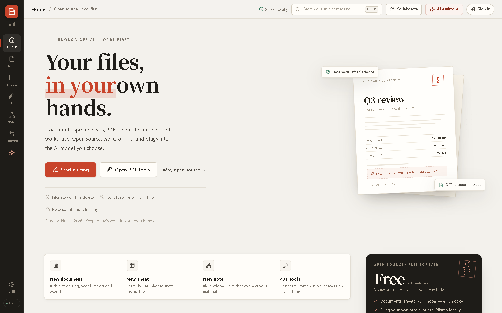
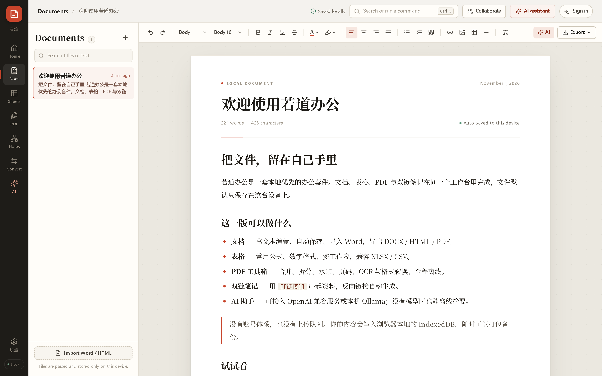
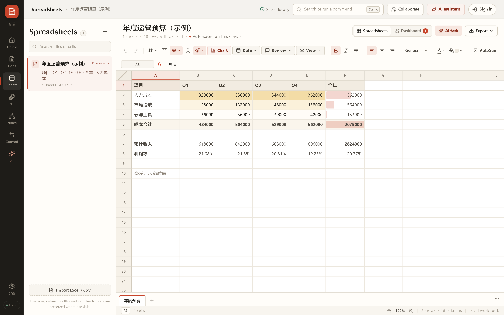
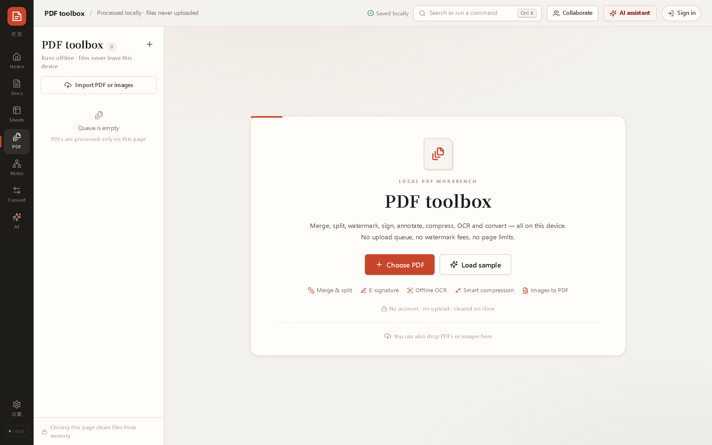
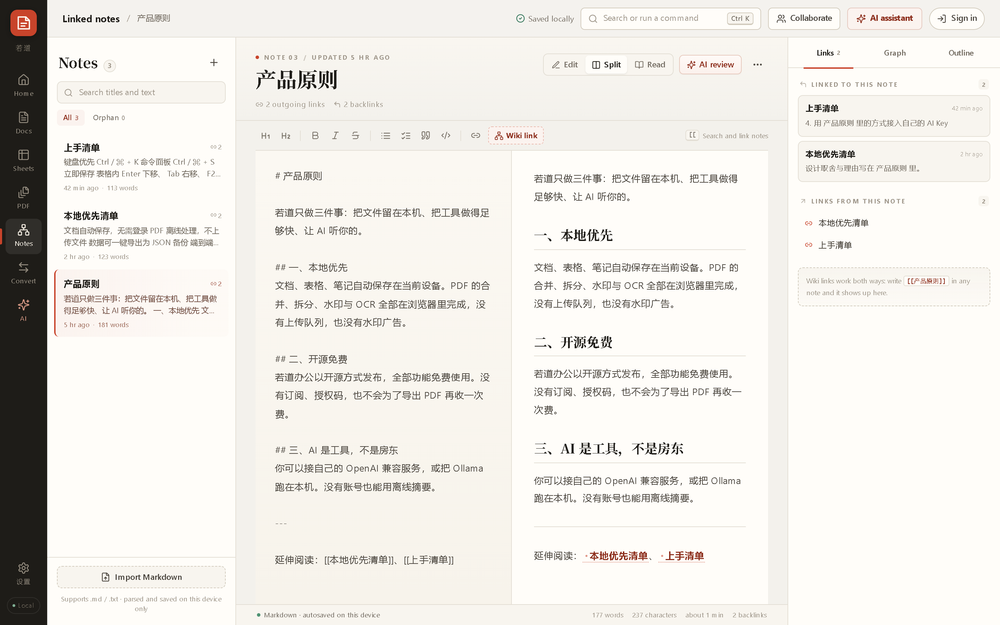
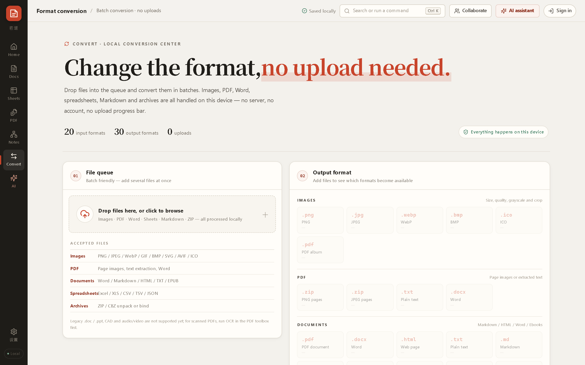
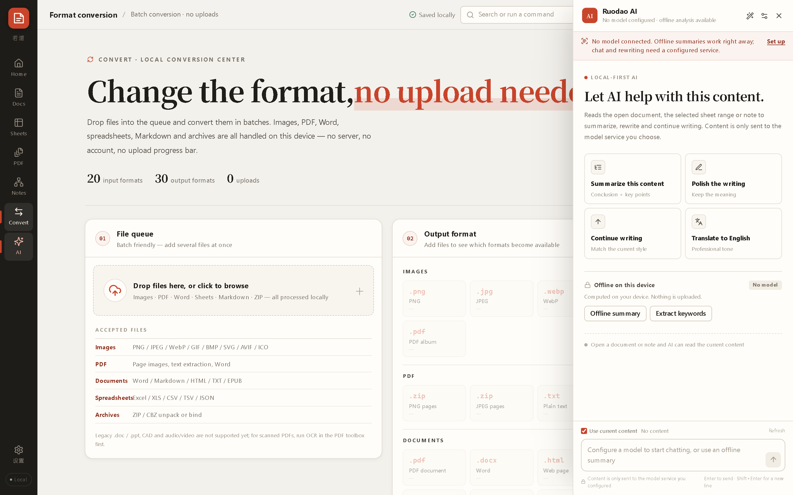
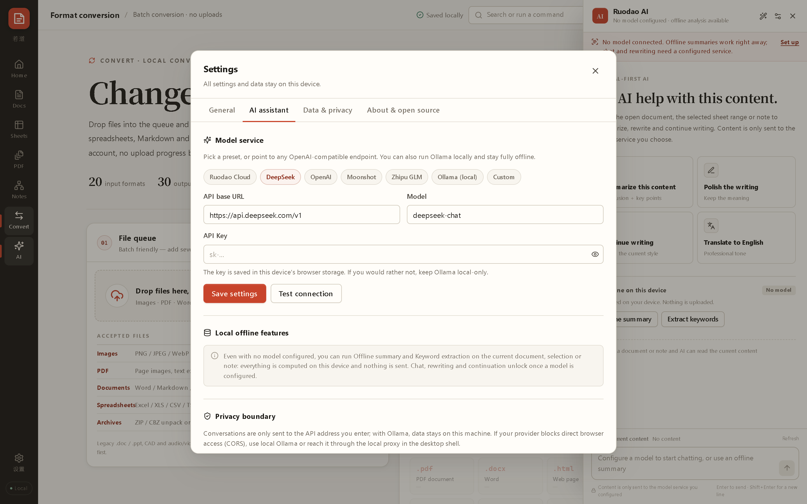

<div align="center">


# Ruodao Office

**A local-first office suite for Windows** — documents, spreadsheets, a PDF toolbox, linked notes and an AI assistant in one quiet workspace.

Your files stay on your machine. No account, no upload queue, no subscription.

[](https://github.com/ruodaoai/ruodao-office/releases)
[](LICENSE)
[](#download)
[](https://www.electronjs.org/)
[](https://react.dev/)

**English** · [简体中文](README.md)

[⬇️ Download](https://github.com/ruodaoai/ruodao-office/releases/latest) · [Features](#features) · [Screenshots](#screenshots) · [Tutorial](#tutorial) · [FAQ](#faq)

</div>



## What it is

Ruodao Office is a **local-first** desktop office suite. It gathers the work normally scattered across a handful of websites — writing documents, crunching numbers, handling PDFs, taking notes, converting formats — into one calm workspace that **works without a network connection**.

What sets it apart from online document editors: **no account system, no upload queue, no "your file has been synced to the cloud"**. Content is written to a local IndexedDB database and can be exported as a single JSON file at any time.

| Its position | How it is enforced |
| --- | --- |
| Files belong to you | Local database + whole-archive JSON backup, zero cloud dependency, works offline |
| Open source and free | Every feature unlocked. No subscription, no license fee, no paywall on PDF export |
| AI you control | Bring your own API key or run Ollama locally — content only goes where you point it |
| Bilingual UI | Full Simplified Chinese and English interface, switched at runtime |

## Features

| Module | What it does |
| --- | --- |
| 📄 **Documents** | Rich text editing, autosave, Word/HTML import, export to DOCX / HTML / PDF, word count, full-text search |
| 📊 **Spreadsheets** | Formulas and functions, number formats, multiple sheets, cell styling, charts, XLSX / CSV round-trip |
| 🗂 **PDF toolbox** | Merge, split, watermark, page numbers, e-signature, text/page extraction, offline OCR, compression, image export |
| 🧠 **Linked notes** | Markdown editing, `[[bidirectional links]]`, backlinks, split view, relation graph |
| 🔄 **Format conversion** | 20 input types × 30 output types across images, PDF, documents, spreadsheets and archives — all on-device |
| ✨ **AI assistant** | DeepSeek, any OpenAI-compatible endpoint, local Ollama, or a Ruodao account; summarize, rewrite, translate, continue |
| 👥 **Collaboration** | Real-time co-editing over Yjs with your own WebSocket server, no third-party relay |

## Screenshots

### Home — every file in one place

Recent files, quick actions and where your data lives, at a glance.


### Documents — WYSIWYG, saved as you type



### Spreadsheets — formulas, formats and charts



### PDF toolbox — work without uploading

Merge, split, watermark, sign, OCR and compress locally; page count is not a limit.



### Linked notes — let your material find itself

`[[links]]` generate backlinks automatically, with a relation map beside the editor.



### Format conversion — batch, offline, watermark-free



### AI assistant — your own model



### Settings — switch the interface language

Simplified Chinese and English, applied instantly.



## Download

### Option 1 — Installer (recommended)

**[⬇ Download RuodaoOffice-0.1.0-Setup.exe](https://github.com/ruodaoai/ruodao-office/releases/download/v0.1.0/RuodaoOffice-0.1.0-Setup.exe)** (~125 MB · [all releases](https://github.com/ruodaoai/ruodao-office/releases))

1. Run the installer and choose a target folder (default `%LOCALAPPDATA%\Programs\Ruodao Office`);
2. Desktop and Start-menu shortcuts are created;
3. If Windows SmartScreen warns you, choose **More info → Run anyway** (the installer is not code-signed).

### Option 2 — Portable

**[⬇ Download RuodaoOffice-0.1.0-Portable.exe](https://github.com/ruodaoai/ruodao-office/releases/download/v0.1.0/RuodaoOffice-0.1.0-Portable.exe)** (~114 MB)

Run it from any folder. Nothing is written to the registry, no shortcuts are created.

### Option 3 — Build from source

Requires **Node.js 20+** (22 LTS recommended).

```bash
git clone https://github.com/ruodaoai/ruodao-office.git
cd ruodao-office
npm install

npm run dev        # desktop dev mode (Vite + Electron, hot reload)
npm run dev:web    # browser only
```

| Command | Purpose |
| --- | --- |
| `npm run dev` | Desktop dev mode (Vite + Electron) |
| `npm run dev:web` | Vite dev server only |
| `npm run desktop` | Run the desktop shell against `dist/` |
| `npm run build` | Type check + build the frontend into `dist/` |
| `npm run desktop:pack` | Unpacked build in `release-win/win-unpacked` |
| `npm run desktop:build` | Installer + portable build into `release-win/` |
| `npm run collab` | Collaboration server (`ws://127.0.0.1:1234`) |
| `npm run typecheck` | TypeScript only |

## Tutorial

### 1. Write a document

1. **Documents** in the rail → **+** to create;
2. Headings, bold/italic, lists, quotes, tables, code blocks and images in the toolbar;
3. Autosave kicks in ~550 ms after you stop typing;
4. **Export** offers DOCX / HTML / PDF;
5. **Import Word / HTML** reads existing files.

### 2. Build a spreadsheet

1. **Spreadsheets** → **+**;
2. `Enter` moves down, `Tab` moves right, `F2` edits;
3. Formulas start with `=`, e.g. `=SUM(B2:E2)`, `=IF(F2>0,"over","ok")`;
4. Style ranges, apply number formats, insert charts;
5. Add and rename sheets at the bottom; xlsx import keeps multiple sheets and styles;
6. Export to XLSX / CSV.

### 3. Work with PDFs

Load files into the queue, then pick a tool:

| Tool | Notes |
| --- | --- |
| Merge / Split | Merge in order; split by selected pages, or one page per file |
| Watermark / Page numbers | Custom text and position, applied to the whole queue |
| Signature | Drop in a signature image and stamp it on a page |
| Extract text / pages | Plain text out, or selected pages as a new PDF |
| OCR | Local recognition with tesseract.js, editable afterwards |
| Compress | Three levels balancing size and clarity |
| Export images | PNG / JPG per page at a chosen resolution |

Originals are never modified.

### 4. Keep linked notes

1. **Notes** → new note, written in Markdown;
2. Type `[[` to link another note;
3. The **Related** panel lists backlinks automatically;
4. Toggle **Edit / Split / Read** views;
5. Import existing `.md` files.

### 5. Convert in bulk

Drop files into the queue, choose an output format (PNG → PDF, PDF → Word, Word → Markdown, Excel → CSV, ZIP → unpacked…), then run. Resolution and quality are adjustable; scanned PDFs should go through OCR first.

### 6. Configure the AI assistant

Open the **AI** drawer, then **Settings → AI assistant**:

| Option | Requires | Note |
| --- | --- | --- |
| DeepSeek (default) | API key | Works immediately, model `deepseek-chat` |
| Any OpenAI-compatible API | Base URL + model + key | Self-hosted gateways, Moonshot, Qwen, … |
| Local Ollama | `ollama serve` | Base URL `http://127.0.0.1:11434/v1`, no key, nothing leaves the machine |
| Ruodao account | Sign-in | Use the models configured on your account |

Select text in a document or note, then use the floating AI button to summarize, rewrite, translate or continue in place. **Keys stay local and are excluded from exported backups.**

### 7. Collaboration (optional)

```bash
npm run collab                    # ws://127.0.0.1:1234
COLLAB_PORT=9000 npm run collab   # custom port
```

Open the **Collaborate** panel, enter the server URL and a nickname, then create or join a room.

### 8. Back up and move machines

**Settings → Data & privacy → Backup & migration**: export a full JSON backup (documents, sheets, notes — no AI keys), import it on another device, or clear local data. No account required.

### 9. Switch the interface language

**Settings → General → Interface language**: Simplified Chinese or English, applied immediately. New installs follow the system language; the choice is remembered per device.

## Keyboard shortcuts

| Shortcut | Action |
| --- | --- |
| `Ctrl / ⌘ + K` | Command palette |
| `Ctrl / ⌘ + S` | Save to device now |
| `Enter` / `Tab` / `F2` (sheets) | Move down / right / edit cell |
| `Shift` + click (PDF pages) | Range select |
| `Ctrl / ⌘` + click (PDF pages) | Toggle a single page |

## Data & privacy

- Everything is stored in the local **IndexedDB** — no upload, no telemetry, no sign-in required;
- Only text you explicitly send to AI leaves the machine, and only to the endpoint you configured;
- AI keys stay in local storage and are stripped from backups;
- PDF, image, spreadsheet and document processing all happen in the renderer, with no server involved.

## Tech stack

| Layer | Choice |
| --- | --- |
| UI | React 18 · TypeScript · Zustand · Vite 5 |
| Desktop | Electron 45 · built-in local static server · NSIS / portable packaging |
| Documents | Custom rich-text model · `docx` · `mammoth` · `docx-preview` |
| Spreadsheets | Custom grid and formula engine · `xlsx` / `xlsx-js-style` |
| PDF | `pdf-lib` · `pdfjs-dist` · `tesseract.js` |
| Notes | `marked` · `dompurify` · backlink index |
| Collaboration | `yjs` + `ws` |
| i18n | Typed dictionary keyed by source text, zh-CN + en |

## Project layout

```
ruodao-office/
├── electron/            # main process: window, local static server, menu, downloads
├── src/
│   ├── modules/         # home / docs / sheets / pdf / notes / convert / ai
│   ├── components/      # rail, top bar, command palette, settings, collaboration
│   ├── lib/             # document model, formula engine, xlsx, pdf, markdown, ai, storage
│   ├── i18n/            # locale store + English dictionary (Chinese is the source language)
│   ├── store/           # Zustand stores (library / ui / auth / collab)
│   └── styles/
├── server/collab.mjs    # collaboration server (Yjs + WebSocket)
├── scripts/             # desktop launcher, icon, packaging, screenshots
└── screenshots/         # Chinese screenshots in root, English in screenshots/en
```

## FAQ

**Windows says the app is unsafe?**
The installer is not code-signed. Choose *More info → Run anyway*, or use the portable build.

**Where is my data? How do I move it?**
In the local IndexedDB under the app's user-data folder. Use **Settings → Data & privacy → Export full backup** to move devices.

**Does it need the internet?**
Documents, sheets, PDF, notes and conversion all work offline. Only online AI models need a connection; Ollama keeps everything local.

**Can it open legacy `.doc` / `.xls` files?**
It reads `.docx`, `.xlsx`, `.csv`, `.md` and `.html`. Legacy binary `.doc` / `.xls` and encrypted PDFs should be re-saved first.

**macOS / Linux?**
Only Windows x64 is packaged today. The frontend is a standard web app, so `npm run dev:web` runs on macOS and Linux; desktop shells are planned.

**`npm run dev` opens a browser tab instead of a window?**
Make sure `ELECTRON_RUN_AS_NODE` is not set in your environment — it forces Electron to run as plain Node. The launcher strips it automatically; if a port is taken, a free one is picked (`RUODAO_DEV_PORT=5199 npm run dev`).

## Roadmap

- [ ] macOS / Linux desktop builds
- [ ] Full collab support inside documents and spreadsheets
- [ ] Plugin-style custom tools
- [ ] Read-only mobile companion

## Contributing

Issues and pull requests are welcome. Fork, branch (`feat/…`, `fix/…`), run `npm run typecheck` and `npm run build` before submitting, and describe the motivation, the change and how you verified it.

## License

[MIT](LICENSE) © 2026 Ruodao

See [CHANGELOG](CHANGELOG.md) for release history.

<div align="center">
<sub>Keep your files in your own hands.</sub>
</div>
